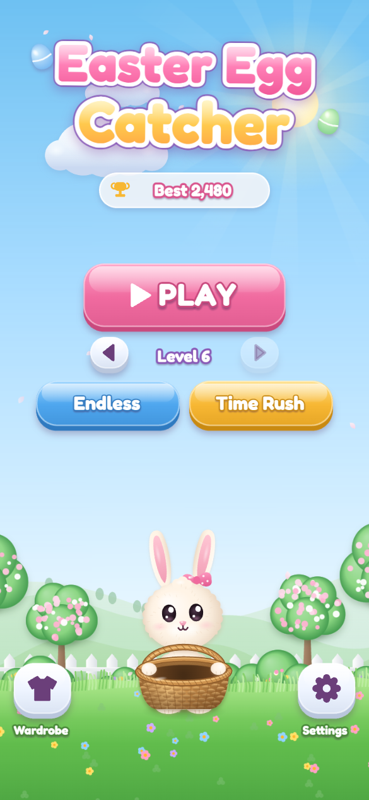
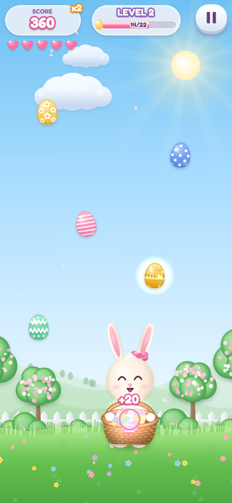
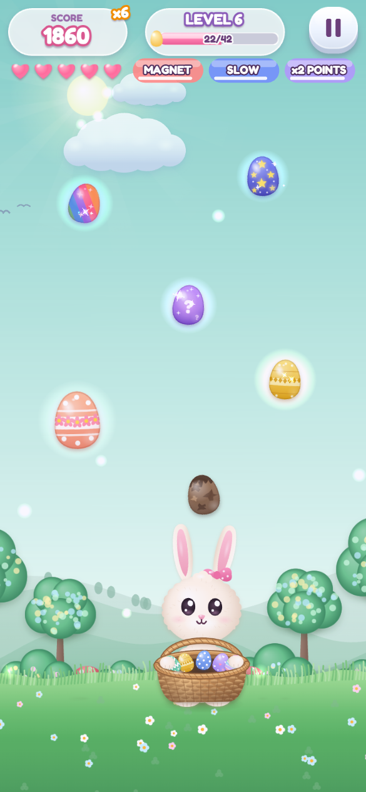
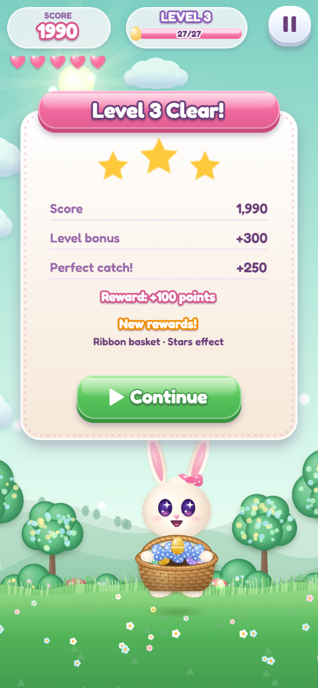
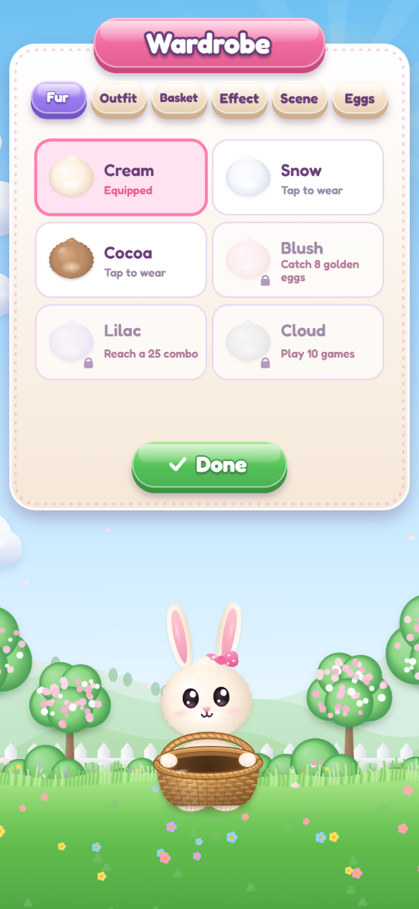
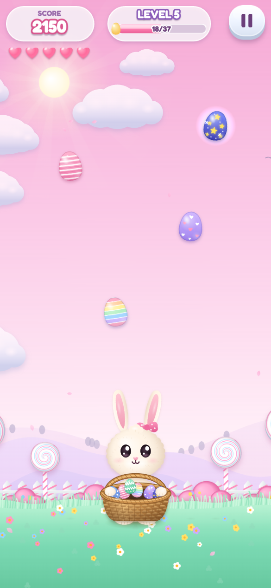
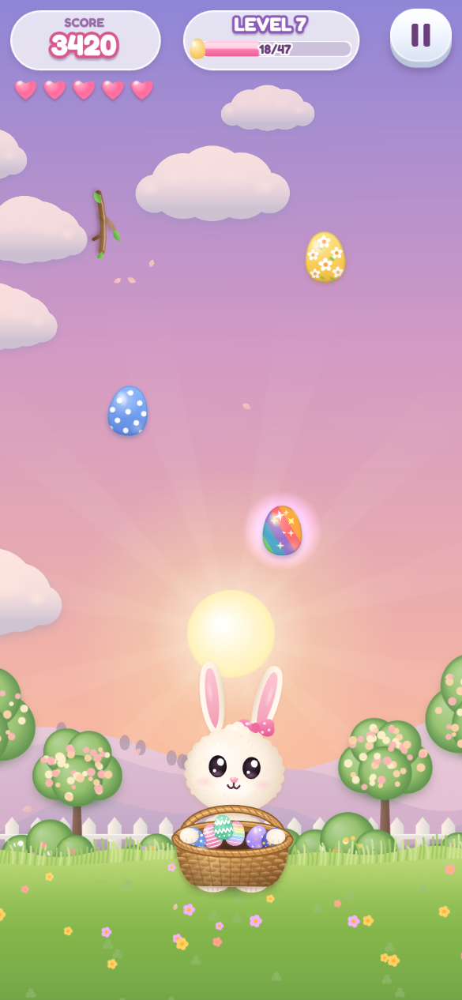

# 🐰 Easter Egg Catcher

A cute portrait-mode arcade game for mobile and desktop browsers, built with **PixiJS 8**. Move the bunny left and right to catch falling Easter eggs in the basket. Chase combos, grab special eggs and unlock cosmetics as you go.

All art is painted in code at startup (Canvas2D gradients, highlights and soft shadows, uploaded as Pixi textures). Music and sound effects are synthesized with WebAudio. The game ships with no image or audio files.

<p align="center">
  
  
  
</p>

<p align="center">
  
  
  
</p>

<p align="center">
  
</p>

## Features

- **An expressive bunny.** Squash and stretch, springy ears, blinking and breathing, plus reactions for catches, special catches, misses, a nearly full basket, game over and victory.
- **11 decorated eggs.** Six standard and rare designs plus five special eggs:
  - **Golden:** worth 100 points.
  - **Prism:** double points for a few seconds.
  - **Star:** slows time.
  - **Giant:** bigger and falls slower.
  - **Mystery:** a random reward.
- **Gentle hazards:** muddy eggs and twigs, introduced in later levels.
- **Fair difficulty.** New content is introduced one step per level, and every egg is placed so it can still be reached.
- **Combos and power-ups.** The score multiplier climbs with consecutive catches, with a short grace period after a miss. Power-ups are a magnet, a big basket, slow time and double points.
- **Three modes:**
  - **Levels:** egg targets and star ratings. You can resume from any level you've reached.
  - **Endless:** difficulty keeps rising and the scenery changes over time.
  - **Time Rush:** 60 seconds, no lives.
- **Four parallax themes:** flower meadow, enchanted forest, candy garden and sunset field.
- **Wardrobe:** unlockable fur colours, outfits, basket skins, catch effects, scenes and an egg collection.
- **Built for phones.** Two control schemes (drag or on-screen arrows), safe-area aware layout, separate music and sound volume, mute, a reduced-effects option, auto-pause when the app goes to the background, and progress saved on the device.

## Run

```bash
npm install
npm run dev        # http://localhost:5173 (also reachable from a phone on the same Wi-Fi)
npm run build      # production build in dist/
npm run preview    # serve the build
```

**Controls:** drag anywhere (default) or hold the on-screen arrows (switch in Settings). On desktop the arrow keys or A/D also work, and Esc or P pauses.

## Project layout

```
src/
  config.js              all balancing: scores, combo, lives, power-ups, difficulty curve, levels, cosmetics
  main.js                Pixi bootstrap, resize, audio unlock, pause on app interruption
  game.js                game controller: input, rules, scoring/combo, level flow, screen flow
  core/                  layout (responsive world units), tweens, object pool
  art/                   procedural painters: eggs, bunny + basket, scenery themes, UI
  entities/bunny.js      bunny rig with spring-based squash/stretch, ear physics, expressions
  entities/eggs.js       pooled falling eggs, gravity, swept basket collision
  systems/spawner.js     what/where/when to spawn; fairness check keeps every egg reachable
  systems/background.js  parallax layers, clouds, birds, petals, theme cross-fades
  systems/effects.js     pooled particles, floating score text, confetti
  systems/audio.js       synthesized music (marimba/bells/pluck) and SFX
  systems/save.js        localStorage: settings, best scores, stats, unlocks, egg collection
  ui/                    HUD, buttons/sliders/toggles, menu/settings/wardrobe/pause/results screens
```

Gameplay tuning (points, combo steps, lives, difficulty, level targets, unlock requirements) is all in `src/config.js`.

## Shipping to Android / iOS

The build is a static web app, so it can be wrapped with [Capacitor](https://capacitorjs.com/):

```bash
npm i -D @capacitor/cli && npm i @capacitor/core @capacitor/android @capacitor/ios
npx cap init "Easter Egg Catcher" com.example.eggcatcher --web-dir dist
npm run build && npx cap add android && npx cap add ios && npx cap sync
```

Lock the orientation to portrait in the native projects. The font (Fredoka) is loaded from Google Fonts. To bundle it offline, download it into `public/` and replace the `<link>` in `index.html` with an `@font-face` rule.
